# 2. Ce que voit le réviseur

L'écran de conduite de mission. Cette page décrit ce qu'il montre et comment il est organisé. Elle
ne contient aucune manipulation.

> **Les images des cinq temps du dossier sont des maquettes de conception, et non des captures
> d'écran.** Elles montrent la structure retenue ; l'écran publié peut différer dans le détail.
>
> Les images prises sur l'installation réelle sont signalées comme telles : l'en-tête, la liste des
> clients, et les quatre images des comptes annuels.

---

## La question à laquelle l'écran répond

**Où en sont mes missions, et sur quoi dois-je agir aujourd'hui ?**

L'écran lit la base directement. Ce qu'il affiche est vrai à l'instant où vous le regardez, et non
à la date de la dernière mise à jour d'un classeur.

---

## L'organisation de l'écran

Toujours la même, quel que soit le dossier ouvert.

| La zone | Ce qu'elle porte |
|---|---|
| **L'en-tête** | Le cabinet, le client sélectionné, l'exercice |
| **Les onglets** | Les 5 écrans : Client et Acceptation, Révision, Valorisation, Arrêté, Référentiels |
| **La bande d'indicateurs** | Cinq compteurs, qui donnent l'état du cabinet en un coup d'œil |
| **La barre des étapes** | Les étapes de l'écran ouvert ; à l'écran Client et Acceptation, les 5 temps du dossier, de la création à l'arrêté |
| **La zone de travail** | Le détail de l'étape ouverte |

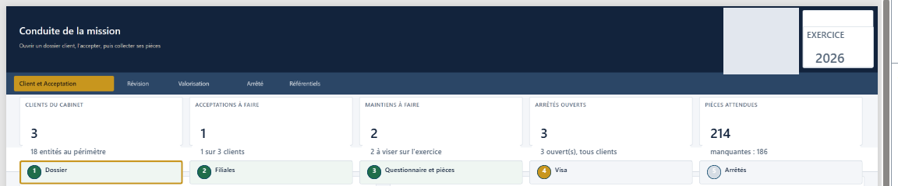

*Capture de l'installation réelle.*

### Les cinq indicateurs de la bande

Ce sont les 5 cartes de l'écran Client et Acceptation.

| L'indicateur | Ce qu'il compte |
|---|---|
| Clients du cabinet | Les dossiers suivis |
| Acceptations à faire | Les dossiers dont l'acceptation n'est pas achevée |
| Maintiens à faire | Les maintiens de mission attendus à la fin d'un arrêté |
| Arrêtés ouverts | Les arrêtés en cours, tous dossiers confondus |
| Pièces attendues | Les pièces attendues des clients : les pièces fournies, et les pièces obligatoires qui manquent ; une pièce facultative non fournie n'y entre pas |

Sous les indicateurs, la liste des clients porte chaque véhicule et ses filiales, avec l'état de
l'acceptation et du maintien pour chacun.

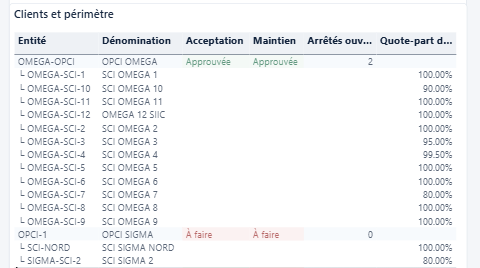

*Capture de l'installation réelle.*

---

## Les cinq temps du dossier

La barre des étapes porte le parcours complet d'un dossier client.

### 1. Le dossier

La fiche du client : identité, dénomination, forme du véhicule, adresse, dirigeant, contact, site
documentaire. Plus l'acceptation et sa date, les maintiens par exercice, les arrêtés, le périmètre
et l'équipe de la mission.

Deux sous-états : **Nouveau dossier**, pour créer, et **Modifier**, pour corriger.

**Un point de conception :** la création d'un client ouvre aussitôt son questionnaire
d'acceptation : un dossier ne peut pas exister sans son questionnaire.

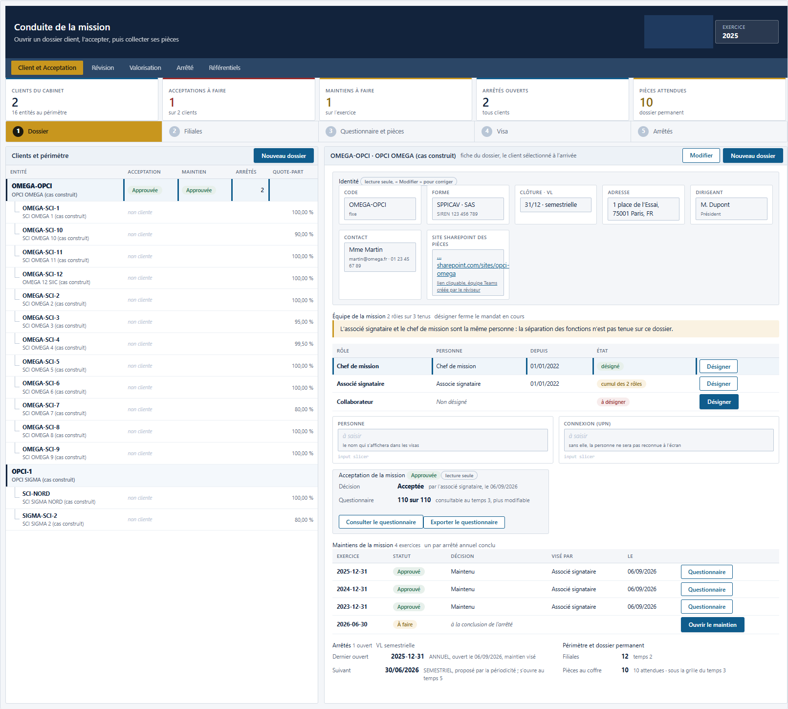

*Maquette de conception. La fiche porte l'identité, l'équipe de la mission avec son alerte de cumul
de rôles, l'acceptation, les maintiens par exercice et les arrêtés.*

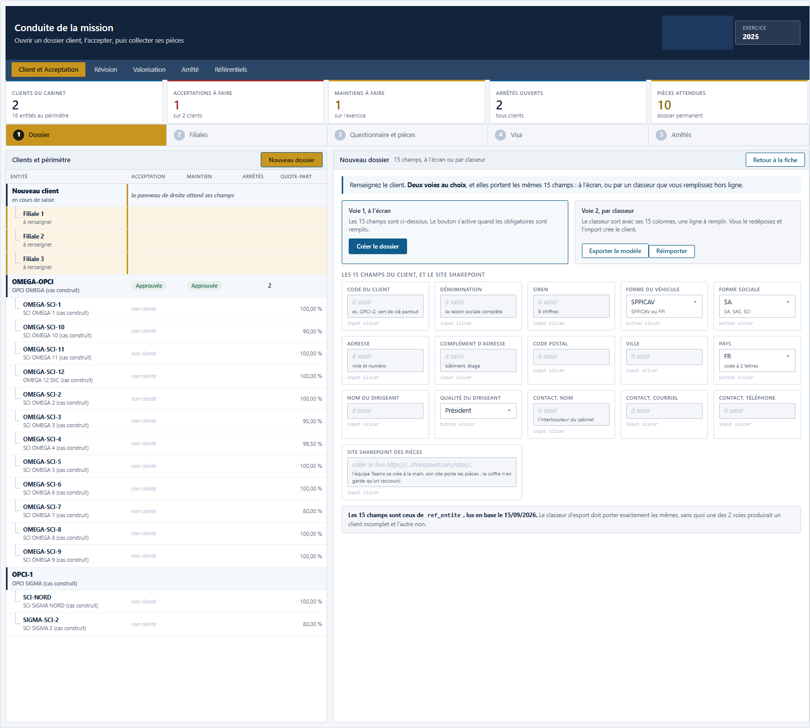

*Maquette de conception. Le sous-état de création.*

### 2. Les filiales

Le périmètre du véhicule. Ajouter une filiale, la modifier, la supprimer.

**La suppression est refusée si la filiale porte des données de mission.** Le refus est motivé, et
il vient de la base. Chaque ajout, modification ou suppression d'une filiale s'inscrit en base dans
la table `journal_perimetre` ; aucune page du rapport n'affiche ce journal.

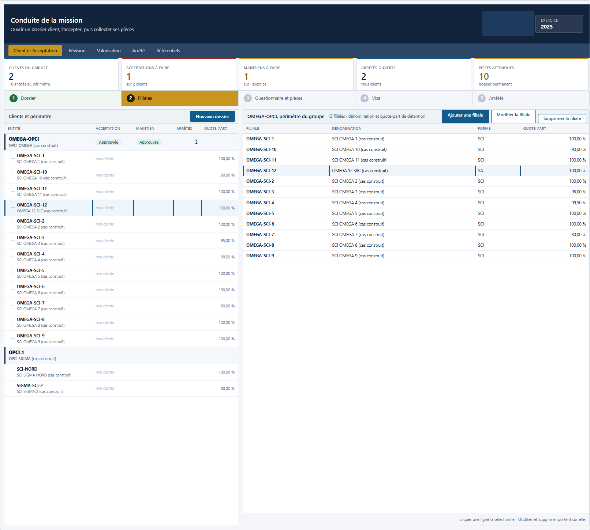

*Maquette de conception.*

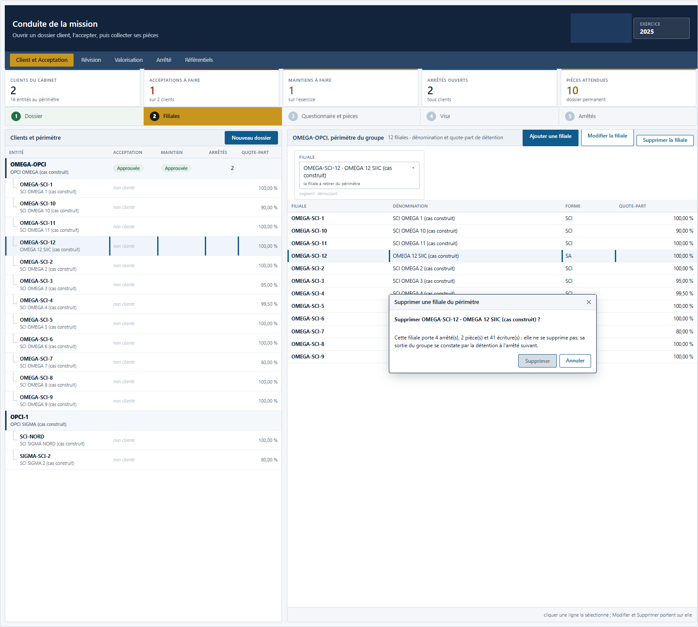

*Maquette de conception. Le refus nomme ce qui s'oppose à la suppression.*

### 3. Le questionnaire et les pièces

La grille des questions d'acceptation, avec pour chacune sa section, sa référence, son énoncé et sa
réponse.

**La réponse s'enregistre au bouton « Valider la réponse »**, pour la question choisie dans la
grille : la réponse, le motif quand elle est NA, et un commentaire. Une réponse vide est refusée.

En dessous, les pièces justificatives déposées, avec leur nature, leur date de dépôt et leur
déposant.

**Retirer une pièce.** Le retrait est réservé aux membres de l'équipe de la mission : associé, chef
de mission, préparateur ou réviseur, reconnus par leur adresse de connexion. Une pièce rattachée à
plusieurs arrêtés se retire arrêté par arrêté : la liste nomme chaque rattachement par le fichier,
la date de l'arrêté et un numéro, et seul le rattachement choisi part. Le retrait exige un motif,
et la base le refuse dans 3 cas :

| Le cas | Le refus |
|---|---|
| Le dossier de l'arrêté est verrouillé | « Le dossier de l'arrêté du 31/12/2025 est visé et verrouillé : la pièce ne s'en retire plus. » |
| La pièce fonde une donnée : des écritures, une expertise, un mouvement d'actif, un rapport annuel, un accord écrit, une feuille de travail | « La pièce fonde une expertise : elle ne se retire pas du dossier. » |
| La pièce satisfait une pièce obligatoire d'une feuille de travail déjà conclue | « La pièce fonde la conclusion de la feuille de travail DEM-VALO-OMEGA-OPCI-20251231 : elle ne se retire pas du dossier. » |

La liste des pièces dit, pour chaque rattachement, si le retrait est possible ou la raison qui
l'empêche : c'est le texte du refus. Le fichier reste dans SharePoint ; le retrait est tracé, et la
liste des pièces retirées donne le fichier, l'arrêté, le motif, l'auteur et la date.

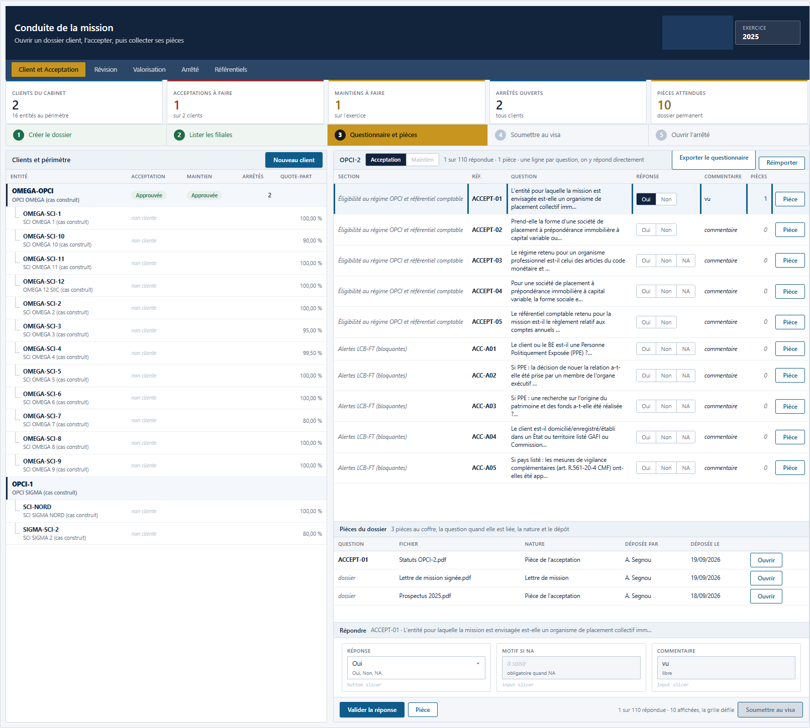

*Maquette de conception.*

### 4. Le visa

La soumission du dossier à l'approbation, puis l'approbation elle-même.

**L'approbation est refusée à la personne qui a soumis.** Voir plus bas, la partie sur la qualité.

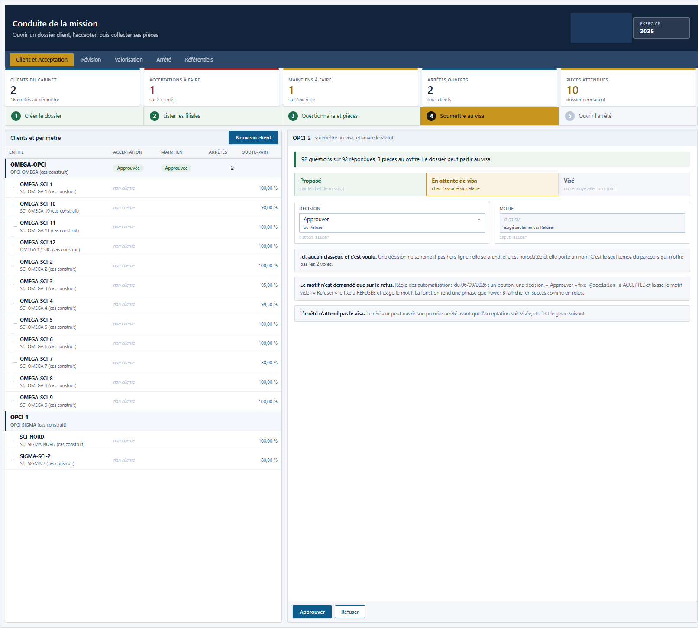

*Maquette de conception.*

### 5. Les arrêtés

Les arrêtés planifiés de l'exercice, et leur ouverture.

**Planifier n'est pas ouvrir.** Un arrêté planifié est une échéance ; un arrêté ouvert est un
travail en cours. La distinction évite qu'on travaille sur un arrêté qui n'a pas été décidé.

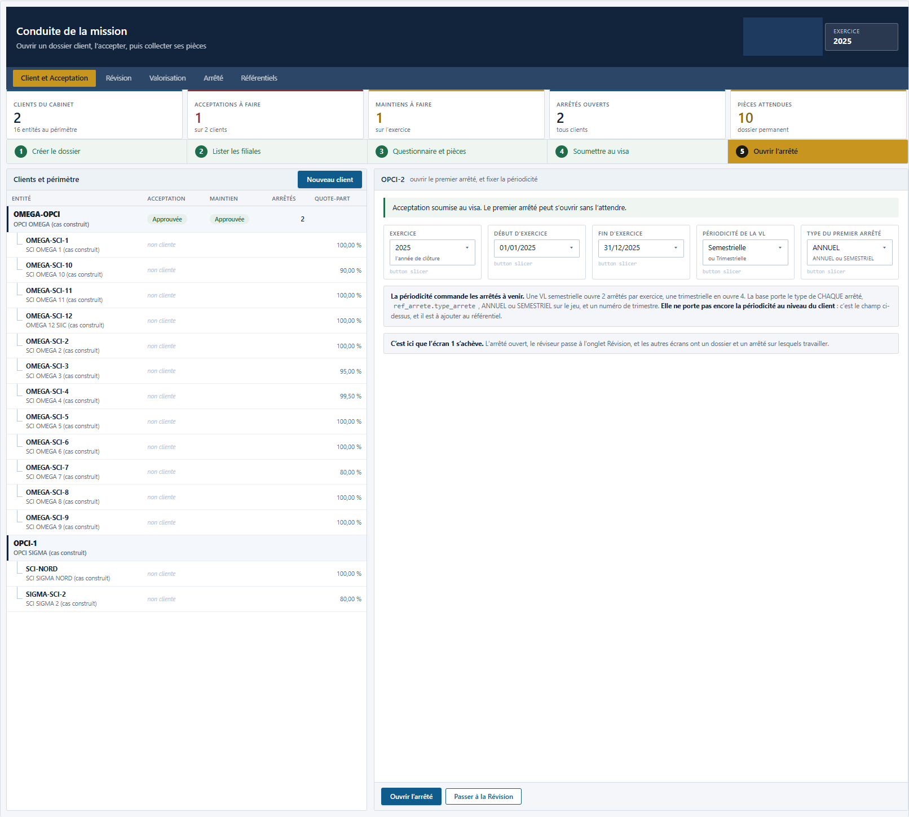

*Maquette de conception.*

**Rouvrir un arrêté clos.** Un arrêté validé pour le client se rouvre en 2 temps, par 2 personnes
distinctes :

1. **La demande**, par un membre de l'équipe qui n'est pas chef de mission, avec un motif : le lot
   tardif qui justifie de rouvrir.
2. **La décision**, par le chef de mission : il accorde la demande, ou il l'écarte avec un motif.
   L'auteur d'une demande ne peut pas la décider.

La réouverture commence par le dernier arrêté clos du client : un arrêté antérieur ne se rouvre
qu'une fois les arrêtés postérieurs rouverts. Avant de décider, le chef de mission lit, ligne par
ligne, l'état d'aujourd'hui et ce que l'accord fera :

| Ce que touche la réouverture | Après la réouverture |
|---|---|
| Visa de clôture | renvoyé ; le visa d'origine demeure |
| Statut de l'arrêté | Ouvert |
| Documents produits | les documents en vigueur passent périmés, avec le motif ; « aucun à périmer » quand aucun n'est en vigueur |
| Forme de l'attestation | « à arrêter de nouveau » si elle est arrêtée ; « inchangée » sinon |
| Rapport client | la dernière publication est maintenue jusqu'à la suivante ; « inchangé » sans publication |
| Verrou et revue | le verrou est levé s'il est posé ; la revue est renvoyée si elle est visée ; « inchangés » sinon |
| Maintien, écritures, lots | inchangés |
| Copies chez le client | marquées périmées ; « aucune copie chez le client » sans copie |

La base tient la règle quel que soit le chemin : un renvoi du visa de clôture qui ne correspond à
aucune demande en attente de son proposant est refusé, même inscrit directement dans la table des
visas.

---

## Les comptes annuels, à l'écran de révision

L'onglet **Révision** porte, pour l'arrêté choisi, le bilan, le compte de résultat et l'annexe, au
modèle du règlement ANC n° 2021-09, modifié par le règlement ANC n° 2024-01 : une page par article,
de l'article 321-2 à l'article 336-3.

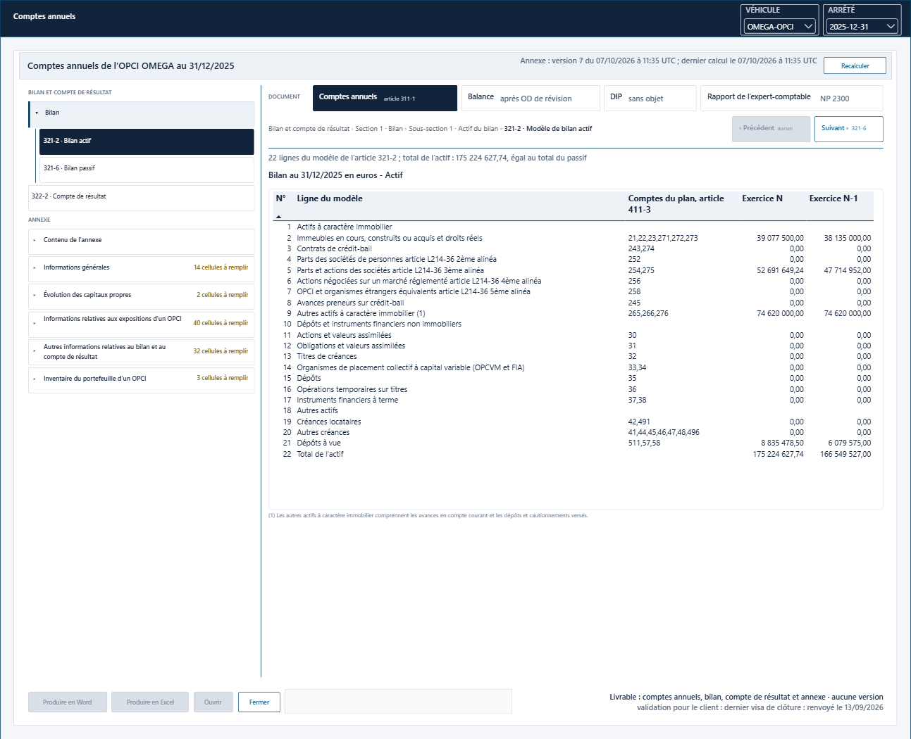

*Capture de l'installation réelle, sur le jeu de démonstration. Le bilan actif au 31/12/2025 : ses
22 lignes du modèle, les comptes du plan de chaque ligne et les 2 exercices.*

### Chaque cellule de l'annexe a un état

| L'état | Ce qu'il veut dire | Ce que le Word imprime |
|---|---|---|
| lue | La base porte la donnée : un solde, une ligne du bilan, un registre | La valeur |
| calculée | Elle se déduit d'autres cellules : un total, un report, une valeur par part | La valeur |
| saisie | Le cabinet l'a écrite ; quand elle remplace une valeur de la base, elle exige un motif | La valeur saisie |
| à remplir | La base ne porte pas la donnée | Une case vide |
| calcul en attente | Elle dépend d'une cellule à remplir | Une case vide |
| sans objet | Le modèle ne l'ouvre pas | Rien |

Une cellule à remplir ne bloque pas la production : le Word sort avec la case vide, et l'écran
compte, article par article, ce qui reste à remplir. Seul le rapprochement du tableau 333-3 avec
les capitaux propres du bilan refuse la production quand il est en écart.

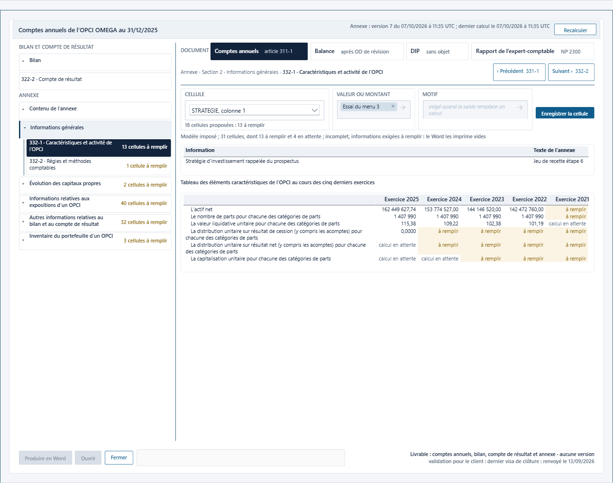

*Capture de l'installation réelle. L'article 332-1 : la cellule choisie, sa valeur, son motif, et
le tableau des 5 derniers exercices avec ses cellules à remplir et en attente.*

La base refuse une saisie là où elle n'a pas de sens : sur une cellule sans objet au modèle, sur une
cellule qui se calcule (la saisie va à ses opérandes), sur une ligne qui reproduit le bilan ou le
compte de résultat (article 331-1), ou avec un montant dans une colonne de texte.

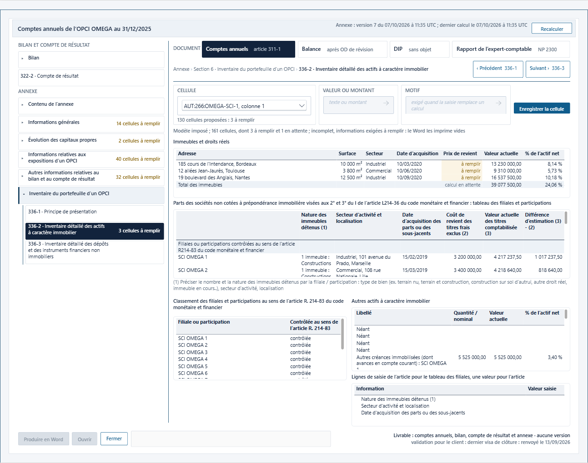

*Capture de l'installation réelle. L'article 336-2 : les immeubles, les filiales et participations
classées au sens de l'article R. 214-83 du code monétaire et financier, et les autres actifs.*

### Le calcul, ses versions, et le bouton « Recalculer »

L'annexe est calculée par la base pour tous les arrêtés de mission du véhicule à la fois : la
colonne de l'exercice précédent lit l'annexe de l'arrêté précédent. Le calcul se fait à la saisie
d'une cellule, au visa de la revue, à chaque demande de document, à la validation pour le client, et
au bouton **Recalculer**.

Chaque calcul qui change au moins une cellule crée une **version** de l'annexe de l'arrêté ; un
calcul sans changement n'en crée pas. Un document produit porte la version qu'il imprime. Quand une
cellule imprimée change, le document produit sur la version précédente passe périmé, avec un motif
qui nomme la cellule, son ancien texte et son nouveau.

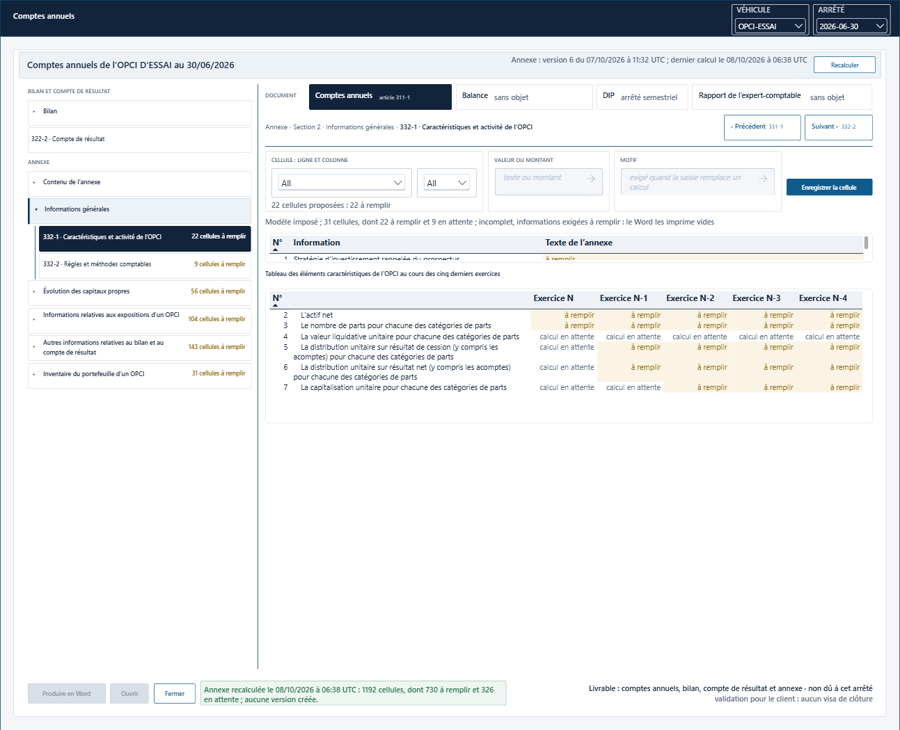

*Capture de l'installation réelle, sur l'arrêté semestriel d'OPCI-ESSAI. En bas, le message du
recalcul : le nombre de cellules, celles à remplir, celles en attente, et les versions créées.*

**Une écriture faite hors du calcul**, par un bouton de saisie de lots, un classeur réimporté ou une
feuille de saisie, laisse une marque de retard sur le véhicule. L'écran la signale, et
l'enregistrement d'un document est refusé tant que l'annexe n'a pas été recalculée : « Document
refusé : les cellules de l'annexe de « OPCI D'ESSAI » sont en retard sur une modification de la
fiche d'une entité du 07/10/2026 à 23:44 ; recalculez, puis produisez de nouveau. »

Chaque cellule dit sa source ou son motif en clair, sans nom de table ni de règle : « registre des
porteurs, souscriptions du 31/12/2024 exclu au 31/12/2025 inclus », « annexe de l'arrêté du
31/12/2024, ligne « Terrains nus », colonne 1 ».

---

## L'écran Valorisation

**Quelle valeur retenir pour chaque actif à l'arrêté, et quelles écritures en découlent ?**

L'écran travaille sur le véhicule et l'arrêté des sélecteurs. Il compte 5 étapes : 1 Arrêter les
valeurs (immeubles, comptes courants, instruments financiers), 2 Lire les différences, 3 Valoriser
les titres, 4 Générer les écritures, 5 Contrôler la balance et le groupe (balance des comptes,
contrôles du groupe, rationalisation et synthèse). L'étape 2 n'a aucun bouton qui écrit.

| Étape | Le bouton | Ce qu'il écrit | Qui |
|---|---|---|---|
| 1, immeubles | Enregistrer l'expertise | La valeur d'expertise de l'immeuble choisi, et le rapport choisi parmi les rapports déposés | Équipe du dossier |
| 1, immeubles | Proposer la valeur retenue | La valeur retenue de l'actif, sa source, sa pièce et le motif de l'écart, soumise au visa | Équipe du dossier |
| 1, immeubles | Viser la valeur, Renvoyer la valeur | Le visa de la valeur retenue ; le renvoi exige un motif | Chef de mission, autre que le proposant |
| 1, immeubles | Exporter le classeur | Le classeur des valeurs du véhicule et de ses filiales, déposé au site du cabinet | Équipe du dossier (51304) |
| 1, immeubles | Réimporter le classeur | Les valeurs du classeur déposé, ligne à ligne ; une ligne refusée est citée | Équipe du dossier |
| 1, comptes courants | Enregistrer la révision | Le montant révisé de l'avance en compte courant choisie, avec son motif | Équipe du dossier |
| 1, instruments | Enregistrer la valeur | La valeur actuelle de l'instrument financier de classe 3 choisi, sa source et sa pièce | Équipe du dossier |
| 3 | Enregistrer le cours | La quantité et le cours du titre inscrit au compte 256 ou 258, avec sa source | Équipe du dossier |
| 4 | Générer le lot | Les différences d'estimation des actifs de l'entité, en lot proposé au visa du chef de mission | Équipe du dossier (51318) |
| 4 | Reprendre l'écart du 275 | Le lot de reprise du compte 275 du véhicule, proposé au visa du chef de mission | Équipe du dossier (51320) |
| 4 | Annuler le lot | Le rejet du lot proposé choisi, avec son motif | Équipe du dossier du lot (51321) |
| 4 | Créer la dérogation | Une dérogation motivée sur la feuille de valorisation ou des participations, qui attend le visa du chef de mission | Équipe du dossier |
| 5, balance | Marquer le compte revu | L'état revu du compte choisi, rattaché à une feuille de travail | Équipe du dossier |
| 5, groupe | Passer les écritures miroir | Un lot d'écritures miroir par entité, pour les flux intragroupe qui restent à passer ; chaque lot attend le visa du chef de mission | Équipe du dossier |
| 5, synthèse | Proposer la synthèse | La synthèse de l'arrêté, soumise au visa ; refusée tant qu'un lot attend son visa ou qu'un contrôle ne passe pas | Équipe du dossier (51319) |
| 5, synthèse | Viser la synthèse, Renvoyer la synthèse | Le visa de la synthèse ; le renvoi exige un motif | Chef de mission |

« Équipe du dossier » : la personne qui clique tient un rôle en cours sur le dossier, ou sur le
véhicule qui détient la filiale. Hors de l'équipe, la base refuse sous le numéro indiqué, à défaut
sous le numéro 50700. Voir plus bas, la séparation des fonctions.

### Ce que le jeu de démonstration montre et ne montre pas

Le jeu de démonstration porte 2 véhicules. OMEGA-OPCI détient 12 filiales, OMEGA-SCI-1 à
OMEGA-SCI-12. OPCI-1 détient 2 filiales, SCI-NORD et SIGMA-SCI-2. Les arrêtés chargés vont du
31/12/2021 au 31/12/2026.

Les données portent sur les arrêtés annuels du 31/12/2022 au 31/12/2025 pour OMEGA-OPCI et ses
filiales, et sur le seul arrêté du 31/12/2025 pour OPCI-1 et ses filiales. Quelques lignes portent
sur le 31/12/2021 et le 30/06/2025 (OMEGA-OPCI, OMEGA-SCI-1). Au 30/06/2026, seule OMEGA-OPCI a
des données aux écrans Valorisation et Arrêté ; au 31/12/2026, seuls l'avancement des étapes et la
rationalisation d'OMEGA-OPCI ont des lignes. Aucun immeuble n'est valorisé à ces 2 arrêtés.

Les messages d'écran partent vides : le premier message apparaît à votre premier clic. Chaque
entité porte 3 mandats ouverts, associé, chef de mission et préparateur ; le script
`sql/90_vous_inscrire_aux_missions.sql` vous y inscrit.

Les contenus des tableaux sont calculés le 24/11/2026, par entité, sur les lignes que le jeu
charge. Le chargement du jeu sur une base vide n'a pas été joué : ce qu'affiche une installation
neuve n'est pas relevé à l'écran.

| Entité | Ce que l'écran montre |
|---|---|
| OMEGA-OPCI, arrêtés annuels 2022 à 2025 | 3 immeubles par arrêté et leurs pièces, 15 expertises ; les différences d'estimation (28 lignes de détail, 4 comptes) ; les comptes courants (13 lignes) ; les titres de ses 12 filiales en valeur actuelle ; la reprise du compte 275 à passer ; la valeur liquidative, l'actif net réévalué, la balance, la rationalisation de l'actif net, les visas de la valorisation. Au 31/12/2025, en plus : 1 évaluation, 2 publications de la valeur liquidative, 12 lignes de cadrage des prêts entre entités du groupe |
| OMEGA-OPCI, 30/06/2026 | La balance (4 comptes), 1 lot de 2 écritures, 1 feuille de travail, l'avancement des 5 étapes, la rationalisation de l'actif net |
| OMEGA-SCI-1 à OMEGA-SCI-12, arrêtés annuels 2022 à 2025 | 1 immeuble par arrêté et ses pièces, 4 ou 5 expertises, sa différence d'estimation, le détail de son actif net réévalué, la balance, les lots d'écritures ; au 31/12/2025, les flux avec le groupe (2 ou 3 lignes) |
| OPCI-1, 31/12/2025 | La balance (3 comptes), 4 différences par compte, la valeur liquidative, l'actif net réévalué, 2 lignes de détail de l'actif net réévalué, 2 lignes de rationalisation des filiales, 1 lot de 3 écritures ; aucun immeuble, aucune expertise, aucune pièce |
| SCI-NORD, 31/12/2025 | La balance (2 comptes), 1 lot de 2 écritures, 2 feuilles de travail |
| SIGMA-SCI-2 | Aucune ligne de dossier à cet écran |

**Vide pour les 16 entités :** les instruments financiers à valoriser, les titres inscrits au compte
256 ou 258 et leurs cours, les écritures miroir du groupe, les révisions de comptes courants, les
synthèses proposées, les comptes de classe 1 hors actif net, la liste des exports du dossier. Il
s'en déduit que les boutons « Enregistrer la valeur » de l'étape 1 et « Enregistrer le cours » de
l'étape 3 n'ont rien à choisir sur le jeu ; ce n'est pas vérifié au clic.

---

## L'écran Arrêté

**Les limites réglementaires sont-elles conclues, la valeur liquidative publiée et la distribution
décidée, avant la validation pour le client ?**

L'écran compte 4 étapes : 1 Ratios réglementaires (la grille des 18 limites de l'arrêté, puis le
calcul et la conclusion de la limite choisie), 2 Valeur liquidative, 3 Distribution annuelle (la
base et le visa par catégorie, puis la décision de l'assemblée), 4 Passer à la validation.
L'étape 3 porte la mention « sans objet » hors de l'arrêté annuel. L'étape 4 n'écrit rien : son
bouton « Ouvrir les Livrables » ouvre l'étape 6 de la Révision, où la validation pour le client se
pose.

| Étape | Le bouton | Ce qu'il écrit | Qui |
|---|---|---|---|
| 1 | Conclure la limite | La conclusion de la limite choisie à l'arrêté | Équipe du dossier (50700) |
| 2 | Publier la VL | La publication de la valeur liquidative calculée de l'arrêté ; elle se vise, elle ne se renvoie pas (50101) | Associé signataire |
| 3 | Proposer la base | La base proposée de la catégorie choisie, et sa source | Préparateur du véhicule (50814) |
| 3 | Viser la catégorie, Renvoyer la catégorie | Le visa de la base proposée ; le renvoi exige un motif | Associé signataire (50051) |
| 3 | Enregistrer la décision | La décision de l'assemblée pour la catégorie choisie : son montant et sa date | Associé du véhicule (51323) |

### Ce que le jeu de démonstration montre et ne montre pas

Même jeu et même méthode que pour l'écran Valorisation.

| Entité | Ce que l'écran montre |
|---|---|
| OMEGA-OPCI | Les ratios, 4 par arrêté annuel de 2021 à 2025 ; la valeur liquidative, de 2022 à 2025 ; les sommes distribuables et les 3 catégories de l'obligation de distribution, de 2022 à 2025 ; le visa de clôture, de 2022 à 2025 ; le journal des visas ; 2 publications de la valeur liquidative au 31/12/2025 |
| OPCI-1, 31/12/2025 | Les 4 ratios, la valeur liquidative, 1 visa au journal ; aucune obligation de distribution, aucune somme distribuable |
| OMEGA-SCI-1 à OMEGA-SCI-12, arrêtés annuels 2022 à 2025 | L'avancement des 5 étapes, les lots d'écritures, 1 ou 2 feuilles de travail, le journal des visas |
| SCI-NORD, 31/12/2025 | L'avancement des étapes, 1 lot, 3 feuilles de travail |
| SIGMA-SCI-2 | Aucune ligne de dossier |

Les ratios, la valeur liquidative et la distribution n'ont de lignes que pour les 2 véhicules.

**Vide pour les 16 entités :** les conclusions sur les ratios, les décisions de distribution, les
seuils propres à un véhicule, les refus du journal des visas. Le jeu ne charge pas la table des
refus : le journal des visas n'y montre que les décisions. Chez vous, cette table se remplit des
refus que prononcent vos propres procédures.

---

## L'écran Référentiels

**Quels référentiels le cabinet tient-il, et quelles questions de référence restent à valider ?**

L'écran porte sur les référentiels du cabinet, et non sur un dossier ; seul le seuil propre à un
véhicule vise un véhicule. Il compte 3 étapes : 1 Voir l'inventaire (les référentiels du cabinet
par domaine, et la fiche du référentiel choisi), 2 Mettre à jour un référentiel, en 2 volets, « Mis
à jour par le cabinet » et « Fixés par un texte », 3 Valider les questions de référence. L'étape 1
n'écrit rien : « Modifier le référentiel » et « Consulter le référentiel » ouvrent l'un ou l'autre
volet de l'étape 2.

| Étape | Le bouton | Ce qu'il écrit | Qui |
|---|---|---|---|
| 2, cabinet | Modifier la valeur | La nouvelle valeur dans la colonne choisie de la ligne choisie | Teneur du référentiel (50859) |
| 2, cabinet | Ajouter la ligne | Une ligne copiée de la ligne choisie, sous le code et le libellé saisis | Teneur (50859) |
| 2, cabinet | Changer le code | Le nouveau code de la ligne choisie | Teneur (50859) |
| 2, cabinet | Écarter la ligne | La mise hors d'usage de la ligne choisie, sans la supprimer, avec un motif | Teneur (50859) |
| 2, cabinet | Supprimer la ligne | La suppression de la ligne choisie, si aucune autre donnée de la base ne l'emploie (50844) | Teneur (50859) |
| 2, cabinet | Exporter le classeur | Le classeur du référentiel choisi, déposé au site du cabinet | Teneur (51324) |
| 2, cabinet | Réimporter le classeur | Les lignes du référentiel, relues dans le dernier classeur déposé | Teneur (50908) |
| 2, cabinet | Rattacher le fichier | Le fichier nommé, déposé au dossier Modèles, rattaché à la ligne choisie | Associé (50908) |
| 2, texte | Enregistrer le seuil du véhicule | Le seuil de la limite choisie pour le véhicule choisi, sa date d'effet et son motif | Associé (50859) |
| 3 | Valider les questions du cycle | La validation des questions à auditer du cycle ou de la phase choisi | Associé (50875) |
| 3 | Écarter la question | L'écart de la question choisie, avec un motif | Associé (50875) |
| 3 | Ajouter la question | Une question sur la tenue de la comptabilité, au cycle ou à la phase choisi, avec son sujet et son niveau | Associé (50875) |
| 3 | Exporter les niveaux | Le classeur des niveaux de programme, déposé au site du cabinet | Associé ou réviseur (51324) |
| 3 | Réimporter les niveaux | Les niveaux de programme, relus dans le dernier classeur déposé | Associé (50908) |

Le teneur d'un référentiel est l'associé ; pour les questions de révision et de mission, l'associé
ou le réviseur. Sur cet écran, un mandat en cours sur un dossier quelconque suffit.

### Ce que le jeu de démonstration montre et ne montre pas

L'écran lit le socle, le même pour toutes les entités : 44 référentiels, 2 728 lignes, 620
questions, 18 cycles ou phases. Les seuils du véhicule ont des lignes pour OMEGA-OPCI (8 arrêtés)
et pour OPCI-1 (31/12/2025), aucune pour les 14 filiales. Même méthode que pour l'écran
Valorisation.

**Vide :** la liste des classeurs du cabinet, tant que vous n'en avez pas rattaché ; l'emploi des
118 contrôles, qui compte leurs relevés. Lancez `EXEC dbo.pr_relever_controles;` pour obtenir les
premiers relevés de votre base. Les paramètres qui désignent l'infrastructure d'un cabinet ne sont
pas chargés : seuls les 4 seuils du programme le sont.

---

## Les quatre natures d'action, et où l'écran les montre

Un retard n'appelle pas la même décision selon sa cause. L'écran distingue les quatre.

### Le planning

Ce que vous lisez : les arrêtés planifiés, ceux qui sont ouverts, celui qui attend son visa, et
la date de clôture visée.

Ce que vous décidez : relancer le client, ou décaler l'arrêté.

### L'affectation des personnes

Ce que vous lisez : la section **Équipe de la mission**, qui rend **une ligne par rôle attendu**,
tenu ou non.

Une table qui ne montrerait que les mandats
existants laisserait le réviseur deviner qu'il manque un associé. Ici, la ligne « Non désigné » se
lit, et c'est elle qui porte le bouton de désignation.

Trois signaux s'y ajoutent :

| Le signal | Ce qu'il veut dire |
|---|---|
| **À désigner** | Personne ne tient ce rôle |
| **Sans connexion** | Quelqu'un est désigné, mais son compte n'est pas renseigné : il ne sera pas reconnu à l'écran |
| **Cumul à signaler** | La même personne tient l'associé et le chef de mission, ce qui affaiblit la séparation des fonctions |

Ce que vous décidez : désigner quelqu'un, ou répartir autrement.

### La charge de travail

Ce que vous lisez : par dossier, les questions sans réponse, les pièces attendues et celles qui
manquent, les cycles restant à valider.

Ce que vous décidez : prévoir des jours, ou redistribuer.

### La qualité

Ce que vous lisez : ce qui est soumis au visa, ce qui est approuvé, et par qui.

Ce que vous décidez : revoir un travail avant de le viser.

---

## La séparation des fonctions, et pourquoi elle tient

**L'approbation d'un visa est refusée à la personne qui l'a soumis.**

Ce refus n'est pas posé par l'écran. Il est posé par la base de données. Un utilisateur qui
appellerait directement la fonction, sans passer par l'écran, se verrait opposer le même refus.

### Le rôle de la personne qui clique

Chaque bouton qui écrit transmet à la base l'adresse de connexion de la personne qui clique. La
base juge cette adresse avant toute écriture. Deux fonctions de la base portent la règle :

| La fonction | Ce qu'elle vérifie |
|---|---|
| `fn_membre_equipe` | L'adresse tient l'un des 4 rôles ASSOCIE, CHEF_MISSION, PREPARATEUR ou REVISEUR, par un mandat en cours au jour de l'action (date UTC), sur l'entité du dossier ou sur le véhicule qui la détient |
| `fn_peut_viser_nature` | La personne tient, sur l'entité et à la date, un rôle habilité à viser la nature en cause, selon la table `role_nature_visa` |

Les refus de ce contrôle portent les numéros 51300 à 51325. Ils refusent l'action à qui n'est pas
de l'équipe du dossier, sauf 3 :

| Le refus | L'action | Réservée à |
|---|---|---|
| 51322 | « Reprendre » une acceptation refusée (écran Client et Acceptation, temps 4) | Qui peut viser l'acceptation : l'associé |
| 51323 | « Enregistrer la décision » de distribution (écran Arrêté, étape 3) | L'associé du véhicule |
| 51324 | Le dépôt du classeur d'un référentiel ou des niveaux de programme (écran Référentiels) | Le teneur du référentiel |

Au rapport, les boutons des actions de ce contrôle passent au gris selon 3 mesures du modèle
`conduite_de_mission`, table `role_mission`, calculées sur la personne connectée :

| La mesure | Ce qu'elle rend | Le bouton grisé |
|---|---|---|
| `Connecte hors equipe du dossier` | 1 quand la personne connectée ne tient aucun des 4 rôles sur l'entité choisie, ni sur le véhicule qui la détient | Les boutons des actions réservées à l'équipe, et les 2 boutons d'export de l'écran Référentiels, par leur mesure de fond |
| `Viseur acceptation connecte` | L'adresse de la personne connectée si elle peut viser l'acceptation du client choisi ; vide sinon | « Reprendre » |
| `Associe du vehicule connecte` | L'adresse de la personne connectée si elle est associée du véhicule choisi ; vide sinon | « Enregistrer la décision » |

Le gris est une couleur de fond, posée par une mesure : le bouton gris reste cliquable, et le refus
vient alors en français.

**La conséquence pratique :** griser un bouton évite un clic inutile, et ne protège rien. La
protection est en base.

---

## Ce que l'écran ne fait pas

| Ce qu'il ne fait pas | Pourquoi |
|---|---|
| Il ne calcule pas la charge en heures | Aucune saisie de temps n'alimente la solution |
| Il n'alerte pas par courriel | Il affiche, il ne pousse pas |
| Il n'atteste pas la conformité à la norme | Il en porte la trace. L'appréciation reste au professionnel |

---

Suite : [3. Ce que voit le client](03-ce-que-voit-le-client.md)

[Revenir au sommaire](../../README.md) · [Les treize étapes](../faire/etape-01-ouvrir-la-capacite.md)
