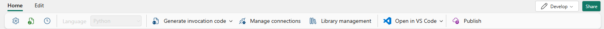
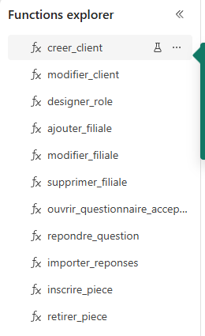

# Étape 8. Connecter les fonctions à la base

**Durée :** quelques minutes par ensemble de fonctions, plus 2 minutes d'attente imposée entre deux
publications. **Qui :** analyste recommandé, faisable seul.

---

## Ce que vous allez faire

Pour chaque ensemble de fonctions : vérifier sa connexion à la base et ses bibliothèques, puis le
publier.

## Les ensembles de fonctions, et ce qu'ils emploient

| L'ensemble | Ses boutons | Ses connexions | Ses bibliothèques |
|---|---|---|---|
| fn_ecran_client | L'écran Client et Acceptation, la page Pièce justificative | DossierOPCI, Coffre | De PyPI : fabric-user-data-functions, openpyxl |
| fn_ecran_revision | L'écran Révision et ses pages | DossierOPCI, Coffre | De PyPI : fabric-user-data-functions, openpyxl |
| fn_ecran_valorisation | L'écran Valorisation | DossierOPCI, Coffre | De PyPI : fabric-user-data-functions, openpyxl |
| fn_ecran_arrete | L'écran Arrêté | DossierOPCI | De PyPI : fabric-user-data-functions |
| fn_documents | La production des documents, aux pages de l'écran Révision | DossierOPCI, Coffre | De PyPI : docxtpl, fabric-user-data-functions, openpyxl |
| fn_valorisation | La génération du lot de valorisation, à l'écran Valorisation | DossierOPCI | De PyPI : fabric-user-data-functions. Privée : la roue `moteur_opci` |

Les versions sont celles du fichier `definition.json` de chaque ensemble, dans `fabric/`, section
`libraries` : `public` pour les bibliothèques de PyPI, `private` pour la roue.

**La roue `moteur_opci`** porte le calcul des différences d'estimation. Pour chaque actif, elle
déduit du poste du bilan le compte de différence d'estimation et sa contrepartie, puis les lignes du
lot : l'écart entre la valeur actuelle et le prix de revient, moins ce qui est déjà comptabilisé. La
base contrôle le lot et le propose au visa. Le fichier `.whl` est une archive zip : son code s'y lit.

**`fn_valorisation` a son point de terminaison public activé.** Sa fonction `generer_lot_valorisation`
porte `isPublicEndpointEnabled` à `true` dans son `definition.json` : votre copie le porte aussi.

**`fn_documents` lit un modèle Word.** Ses fonctions fabriquent les documents sur le modèle Word du
cabinet, qu'elles lisent au site SharePoint du cabinet, bibliothèque Documents, dossier `Modeles`,
sous le nom `modele_livrables_opci.docx`. Ce dépôt ne fournit pas ce modèle. Sans lui, la production est
refusée par ce message : « Production refusée : le modèle Word du cabinet est introuvable. Il se
dépose sur le site du cabinet, bibliothèque Documents, dossier Modeles, sous le nom
modele_livrables_opci.docx. »

## Pourquoi

Les fonctions sont ce que les boutons de l'écran appellent. Elles reçoivent les paramètres,
appellent une procédure de la base, et rapportent le résultat.

**Un bouton n'appelle qu'une fonction publiée, avec ses bibliothèques.** L'éditeur décrit ainsi la
publication : « After your functions are published, other users and Fabric items can run your
functions. » Et pour les bibliothèques : « Select Publish to apply your library changes. »

**Ce que la synchronisation Git apporte :** le code de chaque ensemble, la liste de ses fonctions,
ses connexions désignées par leur alias, et ses bibliothèques, celles de PyPI par leur nom et leur
version, la roue privée par son fichier, rangé dans `privateLibraries/`. C'est la forme que
l'éditeur documente pour la définition d'un ensemble de fonctions : un fichier
`privateLibraries\<libraryname>.whl` à côté de `definition.json` et de `function_app.py`.

**Publier après la synchronisation.** L'éditeur range la mise à jour depuis Git parmi les
publications soumises à l'attente de deux minutes (« the GIT import action »), et un billet de son
blog demande de publier après la synchronisation pour rendre les fonctions appelables. La
vérification de cette page dit, ensemble par ensemble, si la publication est faite.

[Comprendre les trois couches](../comprendre/06-les-trois-couches.md)

---

## Avant de commencer

- L'étape 7 doit être faite.
- **Vous devez être propriétaire des ensembles de fonctions.** Si quelqu'un d'autre a fait la
  synchronisation, c'est lui qui doit faire cette étape, ou vous devez la refaire depuis votre
  compte.

---

## Premièrement, la connexion : elle est peut-être déjà là

**Sur une installation réelle du 26/09/2026, les connexions de `fn_ecran_client` et de
`fn_ecran_revision` étaient déjà posées après la seule synchronisation Git, et elles désignaient bien
les éléments du nouvel espace de travail.**

La raison : la fonction désigne sa connexion par un **alias**, `DossierOPCI` pour la base et
`Coffre` pour le lakehouse, et non par un identifiant. La plateforme résout cet alias dans l'espace
où la fonction se trouve.

1. Ouvrez l'ensemble de fonctions, puis **Manage connections** dans le bandeau.
2. Lisez le tableau. Vous devez y voir une ligne par connexion de la colonne « Ses connexions » du
   tableau du haut. Pour `fn_ecran_client` :

| Alias | Source | Type | Location |
|---|---|---|---|
| Coffre | Coffre | Lakehouse | *le nom de votre espace de travail* |
| DossierOPCI | DossierOPCI | SqlDbNative | *le nom de votre espace de travail* |

3. **Si la colonne Location porte le nom de votre espace sur chaque ligne, la connexion est faite.**
   Passez aux bibliothèques.
4. **Si une ligne manque, ou si Location porte un autre espace**, suivez la procédure ci-dessous.

### La procédure, si une connexion manque

Les deux boutons dont vous avez besoin sont dans le bandeau du haut : **Manage connections** et
**Publish**.

1. Dans votre espace de travail, ouvrez l'ensemble de fonctions.
2. Dans le bandeau du haut, cliquez sur **Gérer les connexions**.
3. Cliquez sur **Ajouter une connexion de données**.
4. Dans la liste, choisissez l'élément de la ligne qui manque : votre base **DossierOPCI**, ou le
   coffre **Coffre**.
5. Validez.

---

## Deuxièmement, les bibliothèques

1. Dans l'ensemble de fonctions, cliquez sur **Library management** dans le bandeau.
2. Comparez la liste à la colonne « Ses bibliothèques » du tableau du haut.
   `fabric-user-data-functions` y figure toujours : l'éditeur l'inclut par défaut, et elle ne se
   retire pas.
3. **Une bibliothèque de PyPI manque :** cliquez sur **Add from PyPI**, saisissez son nom, puis
   choisissez la version écrite dans `definition.json`.
4. **La roue `moteur_opci` manque**, sur `fn_valorisation` : cliquez sur **Upload**, puis
   choisissez le fichier `.whl` du dossier `fabric/fn_valorisation.UserDataFunction/privateLibraries/`
   de votre copie du dépôt.

L'éditeur demande une roue de moins de 30 Mo, indépendante du système d'exploitation. Celle du dépôt
remplit les deux conditions : sa taille se compte en kilo-octets, et son nom finit par
`py3-none-any.whl`, la marque d'une roue en Python pur, pour tout système.

---

## Troisièmement, publier, un ensemble après l'autre

1. Toujours dans l'ensemble de fonctions, cliquez sur **Publish** dans le bandeau.
2. Attendez la fin. La barre d'état, en bas, porte alors l'heure de la dernière publication
   réussie.
3. Passez à l'ensemble suivant, **deux minutes après** la publication précédente.

---

## Deux comportements attendus

### Le refroidissement de deux minutes

**La plateforme impose deux minutes d'attente entre deux publications successives.** L'éditeur
l'écrit : « After publishing your functions, you need to wait at least two minutes before publishing
again. » Il compte parmi ces publications la mise à jour depuis Git. Si vous publiez un ensemble de
fonctions trop vite après le précédent, un message vous le signale.

Attendez, puis recommencez.

### Seul le propriétaire peut publier

**Une personne qui n'est pas propriétaire d'un ensemble de fonctions ne peut pas le publier**, même
si elle est administratrice de l'espace de travail.

**Ce que cela implique pour un cabinet :** installez depuis le compte qui restera responsable de la
solution. Si la personne qui a installé quitte le cabinet, la republication des fonctions demandera
un transfert de propriété.

---

## Vérifier que c'est fait

Pour chaque ensemble de fonctions :

1. **Library management** montre chaque bibliothèque à l'état « Published ». L'éditeur l'écrit :
   « The library status changes from Saved to Published after publishing completes. »
2. Passez en mode **Run only**, par le sélecteur de mode. La liste ne montre alors que les
   fonctions publiées, et elle doit porter celles de l'ensemble.
3. La barre d'état porte l'heure de la dernière publication réussie.

Les fonctions se lisent dans le volet de gauche.

Le premier appel réel d'une fonction se fait par son bouton, une fois l'étape 10 faite.

---

## Si cela ne marche pas

| Le symptôme | La cause |
|---|---|
| « Connexion introuvable » | La connexion n'a pas été validée, ou le mauvais élément a été choisi |
| La publication échoue sans message clair | Les deux minutes de refroidissement. Attendez et recommencez |
| « Vous n'êtes pas autorisé à publier » | Vous n'êtes pas propriétaire de cet ensemble de fonctions |
| Une bibliothèque reste à l'état « Saved » | La publication n'a pas été lancée, ou n'a pas abouti. Attendez deux minutes et publiez de nouveau |
| La publication ou l'envoi de la roue échoue sur une erreur CORS | Votre réseau bloque les requêtes `multipart/form-data` ou l'envoi de fichiers vers Fabric : l'éditeur demande qu'il les autorise |
| La fonction répond, mais une erreur SQL apparaît | L'étape 7 n'est pas faite, ou pas entièrement |
| Un bouton de production refuse : « le modèle Word du cabinet est introuvable » | Le modèle Word n'est pas déposé au site du cabinet, voir `fn_documents` plus haut |

Si la fonction répond mais qu'un bouton de l'écran ne fait toujours rien, la cause est l'étape 10,
qui n'est pas encore faite.

---

## Ce que vous venez de poser, et ce qui manque encore

| Couche | État |
|---|---|
| Les définitions | Posées à l'étape 6 |
| Les données | Posées à l'étape 7 |
| La connexion, les bibliothèques et la publication des fonctions | **Posées maintenant** |
| Le modèle vers la base | Étape 9 |
| Les boutons vers les fonctions | Étape 10 |

---

## Les pages de l'éditeur, relues le 25/10/2026

| Ce qui est affirmé ici | La page de l'éditeur |
|---|---|
| Le fichier `privateLibraries\<libraryname>.whl` et la section `libraries` de `definition.json` | Microsoft Fabric REST API, « User Data Function definition » |
| Le dossier `privateLibraries`, et la publication après la synchronisation | Blog Microsoft Fabric, « Using Microsoft Fabric Git integration for User Data Functions », 21/07/2025 |
| **Library management**, **Add from PyPI**, **Upload**, l'état « Published », la roue de moins de 30 Mo | Microsoft Learn, « How to manage libraries for your Fabric User Data Functions » |
| Le mode **Run only**, la barre d'état, le bouton **Publish** | Microsoft Learn, « Using the portal editor » |
| Les deux minutes, la mise à jour depuis Git, le propriétaire, l'erreur CORS | Microsoft Learn, « Service details and limitations » |

---

Suite : [Étapes 9 et 10. Relier la solution à votre espace de travail](etape-09-et-10-relier.md)

[Revenir au sommaire](../../README.md) · [Dépannage](depannage.md) · [Pièces et classeurs](pieces-et-classeurs.md)
