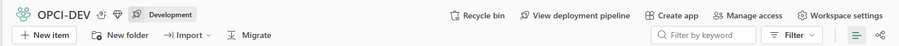
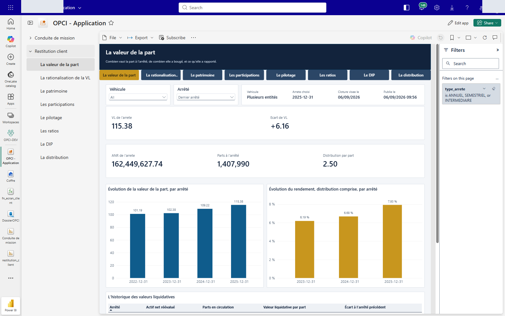
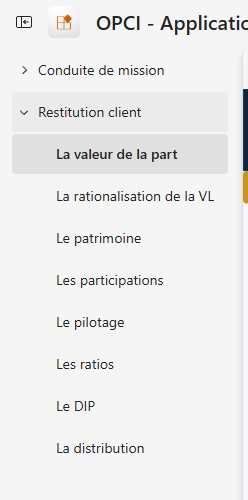

# Étape 11. Publier les deux écrans, à deux publics distincts

Une application organisationnelle est la porte d'entrée de vos collaborateurs. Ils y ouvrent
l'écran de travail sans voir l'espace de travail ni ses éléments techniques.

## Pourquoi passer par une application

Trois raisons.

1. **Vos collaborateurs ne voient que ce qui les concerne.** Ils n'ont accès ni à la base, ni aux
   fonctions, ni au modèle.
2. **Vous contrôlez qui voit quoi**, par audience, ce qui permet de séparer l'écran du cabinet et
   l'écran remis au client.
3. **L'adresse ne change pas** quand vous republiez le rapport.

## Avant l'application : créer un rôle de sécurité par client

**Cette action n'est pas facultative.** Le dépôt livré a un seul rôle, celui du véhicule de
démonstration. Sans un rôle par client réel, un client ouvrant sa restitution verrait les données de
tous les autres.

### Le chemin exact

1. Dans votre espace de travail, **survolez** le modèle sémantique `restitution_client`.
2. Cliquez sur le menu **More options**, les trois points qui apparaissent au survol.
3. Choisissez **Security**.
4. La page de sécurité au niveau des lignes s'ouvre, avec la liste des rôles.
5. Pour chaque rôle, cliquez sur **Assign** et ajoutez les comptes ou les groupes concernés.

**Il faut le rôle de contributeur sur l'espace de travail, au minimum**, pour voir l'option
**Security**.

### Créer un rôle qui n'existe pas encore

La page **Security** assigne des membres à des rôles existants ; elle n'en crée pas. L'éditeur le
dit : on ne peut gérer la sécurité que sur un modèle dont les rôles sont déjà définis.

Pour créer le rôle d'un nouveau client, deux voies.

| La voie | Ce qu'elle demande |
|---|---|
| **Modifier le modèle dans le service** | Ouvrir le modèle, onglet de modélisation, définir le rôle et son filtre |
| Power BI Desktop | Télécharger, définir le rôle, republier |

Le filtre à poser reprend celui du rôle livré : il restreint la table des entités au code du
véhicule du client.

### La limite de la sécurité au niveau des lignes

**La sécurité au niveau des lignes ne s'applique qu'aux lecteurs.** L'éditeur l'écrit : elle ne
s'applique ni aux administrateurs, ni aux membres, ni aux contributeurs de l'espace de travail.

**N'ajoutez donc jamais un client comme membre de votre espace de travail.** Donnez-lui accès par
l'application, avec le rôle de lecteur, et par son audience. C'est la seule configuration où le
cloisonnement tient.

### Vérifier

La page **Security** porte, pour chaque rôle, un menu **More options** avec **Test as role**. Il
ouvre le rapport tel que ce rôle le voit.

**Une réserve :** cette vérification ne fonctionne pas sur un modèle en connexion directe avec
authentification unique. Dans ce cas, connectez-vous réellement avec un compte de test placé dans
le rôle de lecteur.

## Placer l'équipe dans le rôle Reviseur du modèle de conduite

Le modèle `conduite_de_mission` porte un rôle de sécurité, `Reviseur`. Son filtre ne laisse voir à
chaque personne que les entités sur lesquelles son adresse de connexion tient un mandat en cours
dans la table des rôles de mission ([roles/Reviseur.tmdl](../../fabric/conduite_de_mission.SemanticModel/definition/roles/Reviseur.tmdl)).

Le chemin est celui décrit plus haut, appliqué au modèle `conduite_de_mission` :

1. Dans votre espace de travail, survolez le modèle sémantique `conduite_de_mission`.
2. **More options**, puis **Security**.
3. Sur le rôle `Reviseur`, cliquez sur **Assign** et ajoutez les comptes de l'équipe, ou leur groupe.

La même limite vaut ici : un membre ou un contributeur de l'espace voit tous les dossiers. Pour que
chaque collaborateur ne voie que ses dossiers, donnez-lui accès par l'application, avec le rôle de
lecteur. Le rôle ne règle que l'affichage : les écritures restent jugées par la base, sur la table
des rôles de mission.

## Créer l'application

Le bouton **Create app** se trouve dans le bandeau de l'espace de travail.

1. Dans votre espace de travail, cliquez sur **Créer une application**.
2. Donnez-lui un nom, par exemple le nom de votre cabinet suivi de « conduite de mission ».
3. Ajoutez le rapport **Conduite de mission** au contenu.
4. Créez une seconde audience pour **restitution_client**, si vous voulez donner un écran à vos
   clients.
5. Dans **Autorisations**, donnez l'accès aux personnes ou aux groupes concernés.
6. **Publier**.

## Ce que l'application ne fait pas

Elle ne dispense pas des licences. Sur une capacité inférieure à F64, chaque personne qui ouvre
l'application a besoin d'une licence Power BI Pro, qu'elle passe par l'application ou par l'espace
de travail.

Elle ne remplace pas non plus les autorisations sur la base. Les boutons qui écrivent passent par
les fonctions, puis par les procédures de la base, qui vérifient le rôle de la personne connectée
dans la table des rôles de mission. Une personne sans rôle en cours sur un dossier, ni sur le
véhicule qui le détient, voit grisés les boutons des actions de l'équipe, et la base lui refuse ces
actions avec un message qui le dit.

## Vérifier

Demandez à un collègue d'ouvrir l'application. Il doit voir l'écran de conduite de mission et
pouvoir sélectionner un dossier. S'il ne voit rien, vérifiez son autorisation et sa licence.

### Ce que vous devez obtenir

- L'application publiée, avec le rapport **Conduite de mission** pour l'audience du cabinet et, si
  vous l'avez créée, l'audience du client avec **restitution_client**.
- Un collègue de l'audience du cabinet ouvre l'écran de conduite de mission et sélectionne un dossier.
- Avec **Test as role**, ou un compte de test placé dans le rôle de lecteur, le rôle d'un client ne
  montre que les données du véhicule de ce client.
- Un collaborateur placé dans le rôle `Reviseur` et entré par l'application ne voit que les entités
  sur lesquelles il tient un mandat en cours.

---

*Capture de l'installation réelle. Le volet de gauche porte les deux audiences : la conduite de
mission pour votre équipe, la restitution client pour vos clients.*

*Une personne de l'audience client ne voit que la seconde, et les huit pages qu'elle contient.*

Préparez aussi la recette : une des 12 actions demande 2 comptes
distincts, l'approbation de l'acceptation étant refusée à la personne qui a créé le dossier et
réservée à l'associé du dossier ([étape 13](etape-13-passer-la-recette.md)).

---

Suite : [Étape 12. Relier SharePoint : le site du cabinet, la fonction, le site de chaque client](etape-12-relier-sharepoint.md)

[Revenir au sommaire](../../README.md) · [Dépannage](depannage.md) · [Pièces et classeurs](pieces-et-classeurs.md)
