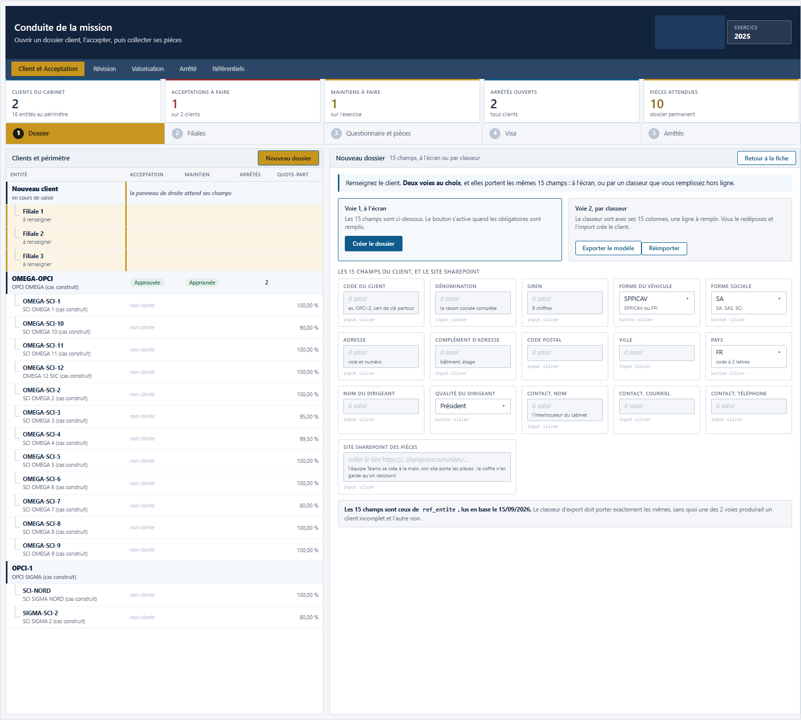
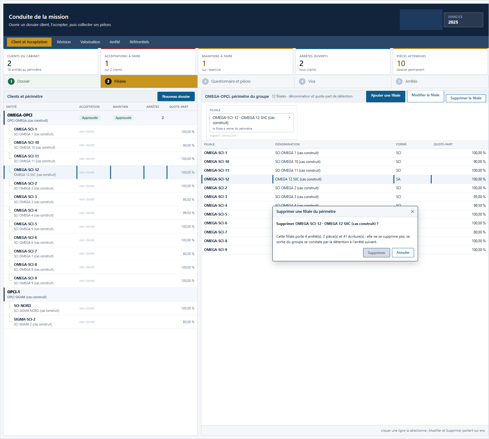
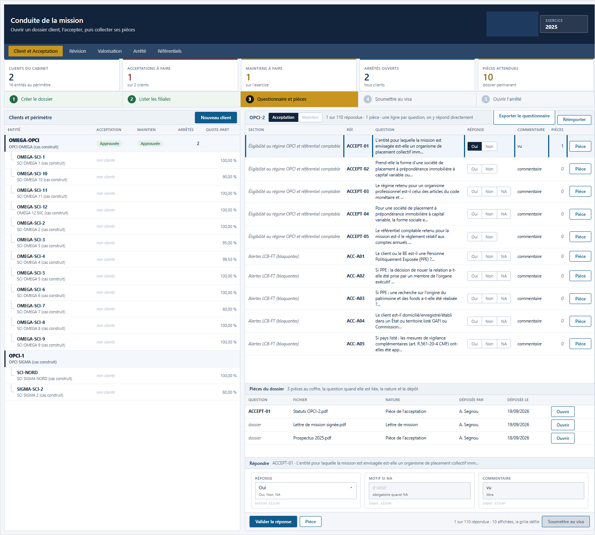
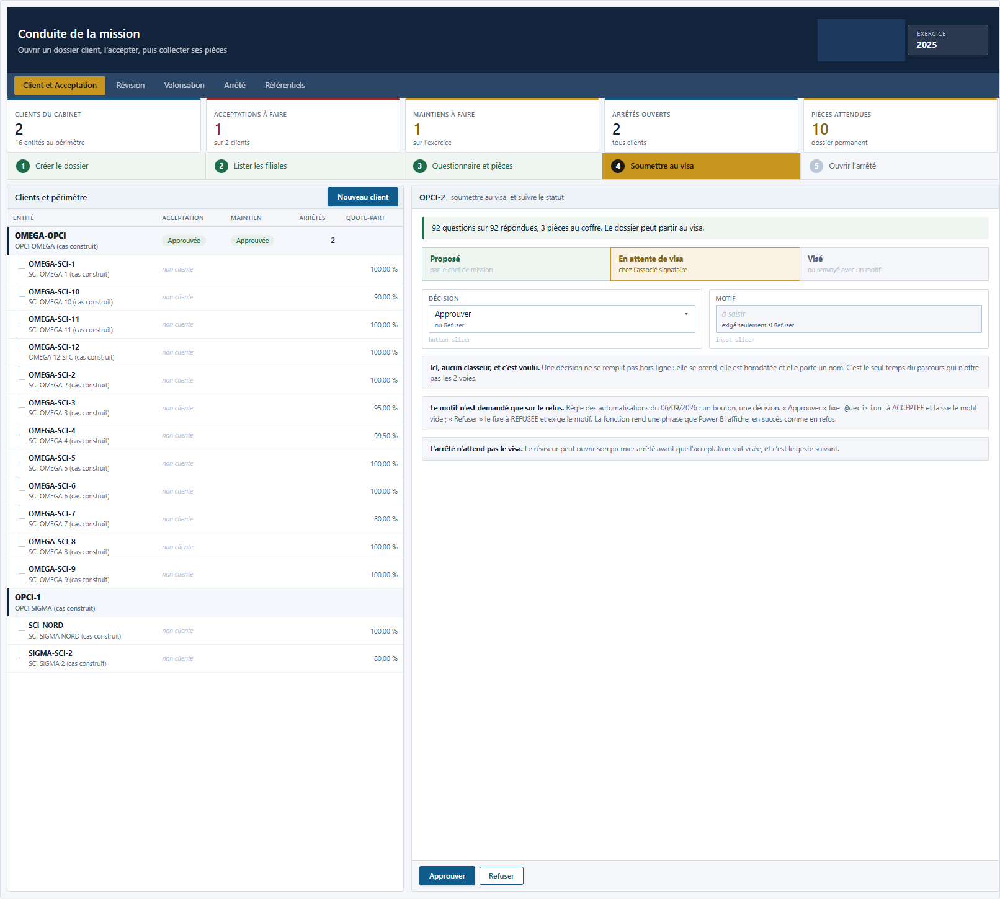
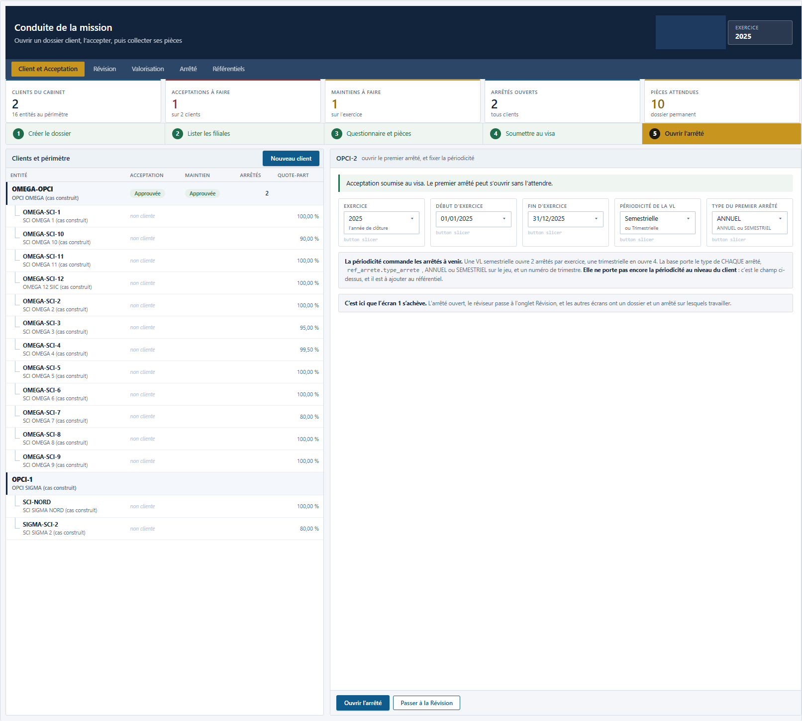

# Étape 13. La recette : douze actions qui prouvent que la solution marche

Ces douze actions parcourent la chaîne complète, du clic jusqu'à l'écriture en base. Si elles passent
toutes, votre installation est bonne.

**L'étape 12 doit être faite avant.** L'action 8 dépose un fichier dans le site SharePoint du client :
sans ce site, le bouton de dépôt n'a pas d'adresse.

Faites-les dans l'ordre : chacune prépare la suivante.

| # | L'action à faire | Où | Ce que vous devez obtenir |
|---|---|---|---|
| 1 | Créer un dossier client | Section Dossier, sous-état Nouveau dossier | Le dossier apparaît, et son questionnaire d'acceptation s'ouvre seul |
| 2 | Modifier les informations du client | Sous-état Modifier | La valeur change, un champ laissé vide reste inchangé |
| 3 | Enregistrer le site du client | Même formulaire | Le lien devient cliquable dans la fiche |
| 4 | Ajouter une filiale | Section Filiales | La filiale entre au périmètre |
| 5 | Modifier une filiale | Section Filiales | Le message nomme le champ modifié et sa nouvelle valeur. La base inscrit le changement dans la table `journal_perimetre`, qu'aucune page du rapport n'affiche |
| 6 | Supprimer une filiale | Section Filiales | Refus motivé si la filiale porte des données de mission |
| 7 | Répondre à une question | Section Questionnaire | La réponse est enregistrée par le bouton « Valider la réponse » |
| 8 | Déposer une pièce | Page Pièce justificative | Le bouton ouvre la bibliothèque « Dépôt du client » ; une fois le fichier déposé et son nom tapé, « Rattacher la pièce » l'inscrit avec sa nature, sa date, son déposant et son lien |
| 9 | Retirer une pièce | Section Questionnaire | Motif obligatoire, refus si la pièce fonde une donnée |
| 10 | Soumettre au visa | Section Questionnaire, bouton « Soumettre au visa » | L'étape du visa s'affiche. Rien ne s'écrit en base : l'acceptation est au statut ouvert depuis la création du dossier |
| 11 | Approuver le visa | Section Visa, **avec un second compte, associé du dossier** | Refusé au compte qui a créé le dossier et à un compte qui n'en est pas l'associé, accepté à l'associé |
| 12 | Ouvrir un arrêté | Section Arrêtés | Les arrêtés de l'exercice sont planifiés et le premier devient ouvert |

## Où se font ces actions

> Les images qui suivent sont des **maquettes de conception**, et non des captures d'écran :
> l'écran de conduite est en cours de pose. Elles montrent la structure retenue, qui ne bougera
> plus. L'écran publié peut différer dans le détail.

**Actions 1 à 3, le dossier.**



**Actions 4 à 6, les filiales.** L'action 6 doit rendre un refus motivé si la filiale porte des
données de mission.



**Actions 7 à 9, le questionnaire et les pièces.**



**Actions 10 et 11, le visa.**



**Action 12, les arrêtés.**



---

L'approbation est refusée à la personne qui a créé le dossier. C'est la séparation des fonctions,
portée par la base. Un utilisateur qui appellerait la fonction sans passer par l'écran recevrait le
même refus.

## Les 2 comptes, et leurs rôles

Pour l'éprouver, il vous faut 2 comptes, inscrits par `sql/90_vous_inscrire_aux_missions.sql` à
l'étape 7.

| Le compte | Ses rôles sur les 16 entités de démonstration, après `sql/90` | Son rôle sur le dossier créé à l'action 1 |
|---|---|---|
| `@vous` | Associé et préparateur | Chef de mission s'il crée le dossier, aucun sinon |
| `@second` | Chef de mission | Chef de mission s'il crée le dossier, aucun sinon |

Celui qui crée le dossier en devient le chef de mission. L'approbation de l'acceptation est réservée
à l'associé du dossier : un chef de mission qui n'a pas créé le dossier reçoit le refus
`Décision refusée : vous ne tenez pas, sur cette entité, le rôle qui décide de l'acceptation. Faire décider par l'associé.`

Avant l'action 11, le compte qui a créé le dossier désigne donc l'autre compte sur la ligne
« Associé signataire », section **Équipe de la mission**, bouton « Désigner ». L'équipe se désigne
par l'associé ou par le chef de mission du dossier.

Un compte qui ne tient aucun rôle en cours sur le dossier, ni sur le véhicule qui le détient, reçoit
un refus de la base sur les actions de l'équipe : ajouter une filiale, répondre au questionnaire,
déposer ou retirer une pièce, entre autres. Le rapport grise les boutons de ces actions pour ce
compte.

## Ce qu'un échec vous apprend

| Symptôme | Cause |
|---|---|
| Le bouton ne fait rien | L'étape 10 n'est pas faite, les boutons appellent encore l'espace d'origine |
| « Fonction introuvable » | La connexion de l'étape 8 n'est pas posée, ou la publication n'a pas abouti |
| L'écran est vide | Les données de l'étape 7 ne sont pas chargées |
| Aucun visuel ne s'affiche | Le modèle n'est pas relié, étape 9 |
| Le bouton de dépôt d'une pièce ne mène nulle part | Le site du client n'existe pas, étape 12 |
| Un bouton est grisé | Un champ attendu est vide, ou votre compte ne tient aucun rôle en cours sur le dossier ni sur le véhicule qui le détient : faites-le désigner, section Équipe de la mission |
| « Action refusée : seule l'équipe du dossier peut… » ou « Retrait refusé : votre adresse de connexion n'est rattachée à aucun membre de l'équipe de ce dossier. » | Votre compte ne tient aucun rôle en cours sur ce dossier ni sur le véhicule qui le détient. C'est le comportement attendu |
| « Écriture refusée : la modification de ce référentiel du cabinet demande le rôle associé… » | À la création ou à la modification d'un dossier, la base juge le compte de la session SQL, celui du propriétaire des fonctions, et ce compte ne tient le rôle d'associé sur aucun dossier : voir `sql/90_vous_inscrire_aux_missions.sql` |

La page [Dépannage](depannage.md) reprend chacune de ces causes en détail.

## Garder une trace

Notez la date de votre recette et le résultat des douze actions. Si vous adaptez la solution plus
tard, cette liste vous dira ce qui marchait avant votre modification.

---

## Les messages que vous devez lire, action par action

Les douze actions ont été jouées le 26/09/2026 sur une installation neuve. Les phrases ci-dessous
sont celles que rend le code de ce dépôt : les messages des actions 1, 3, 7, 8, 9, 11 et 12 ont été
relus depuis dans les procédures et les fonctions, sans être rejoués. **Si vous lisez autre chose,
notez le texte exact et le numéro de l'action : ils servent au diagnostic.**

| # | L'action | Ce que vous devez lire |
|---|---|---|
| 1 | Créer un dossier client | `Client <code> créé, vous en êtes le chef de mission. Questionnaire d'acceptation ouvert : 110 questions. Passez à l'étape 3.` Si le lien du site est saisi à la création, ` Site SharePoint enregistré.` s'insère avant ` Passez à l'étape 3.` |
| 2 | Modifier le client | `Informations de <code> mises à jour. Le code du client ne change pas.` |
| 3 | Enregistrer le site, depuis le formulaire de modification | `Informations de <code> mises à jour. Site SharePoint enregistré. Le code du client ne change pas.` |
| 4 | Ajouter une filiale | `Filiale <code> ajoutée au périmètre de <client>. Sa balance sera réclamée à la révision.` |
| 5 | Modifier une filiale | `Filiale <code> mise à jour : droits de vote → 60,00 %.` |
| 6 | Supprimer une filiale | `Filiale <code> (<dénomination>) retirée du périmètre de <client>.` |
| 7 | Répondre à une question | `Réponse à <référence> enregistrée.` |
| 8 | Déposer une pièce | `Pièce « <nom> » inscrite au dossier de <code>, rattachée à la question <référence>. <n> Ko.` Sans question choisie, la mention de la question n'y est pas |
| 9 | Retirer une pièce | `Pièce « <nom> » retirée du dossier de <code> (question <référence>), arrêté du <jj/mm/aaaa>. Le fichier reste dans SharePoint ; le retrait est tracé.` Devant un code qui commence par une voyelle, « du dossier d' » remplace « du dossier de ». La question et l'arrêté n'apparaissent que si le rattachement en porte. Si la pièce garde d'autres rattachements, une phrase finale le dit |
| 11 | Approuver le visa | `Décision d’acceptation visée pour <code> : mission acceptée.` |
| 12 | Ouvrir un arrêté | `<n> arrêté(s) planifié(s) sur l'exercice, périodicité <périodicité>. Arrêté <aaaa-mm-jj> ouvert : la révision peut commencer.` Un second clic ne planifie rien, n'ouvre rien et rend le même message avec `0 arrêté(s) planifié(s)` : ce n'est pas un refus |

### Trois refus que vous devez provoquer, et qui prouvent les contrôles

| Ce que vous tentez | Le refus attendu |
|---|---|
| Retirer une pièce sans motif | `Le motif du retrait est obligatoire : il reste dans la trace du dossier.` |
| Saisir des droits de vote à 0 | `Les droits de vote se saisissent en pourcentage, de plus de 0 à 100 : 80 pour 80 %.` |
| Enregistrer un site qui n'est pas un site SharePoint | `Le lien attendu est celui du site SharePoint de l'équipe Teams, de la forme https://<cabinet>.sharepoint.com/sites/<nom>.` |

Chacun de ces trois messages vient de la base, et il tiendrait
aussi pour un appel qui ne passe pas par l'écran.

### Ce qui n'a pas été éprouvé, et qu'il faut savoir

**Les messages des actions 8 et 9 ont changé le 28/09/2026**, quand les fichiers sont passés du
coffre à SharePoint. Le texte ci-dessus est celui du code de ce dépôt ; le
parcours complet de l'action 8, dépôt puis rattachement, a été éprouvé au clic le 28/09/2026 sur
l'installation d'origine, pas encore sur une installation neuve.

**Le refus de suppression d'une filiale qui porte des données.** Lors de l'essai, la filiale créée
pour l'occasion ne portait ni écriture ni pièce : elle a donc été supprimée sans refus, ce qui est
le comportement attendu dans ce cas. Pour éprouver le refus, supprimez une filiale du jeu de
démonstration qui porte des écritures.

---

## L'action 11, et ce que la base répond

La base juge, dans cet ordre : la personne qui approuve est-elle une autre que celle qui a créé le
dossier, tient-elle le rôle d'associé du dossier, le questionnaire est-il complet. Le premier message
a été relevé le 26/09/2026 sur une installation neuve ; les 2 suivants sont ceux du code de ce dépôt,
non rejoués.

**Quand celui qui a préparé l'acceptation tente de l'approuver :**

```
Approbation refusée : l'acceptation a été proposée par la même personne. La décision
d'accepter une mission se prend par un autre que celui qui l'a préparée. Faire approuver
par l'associé signataire.
```

**Quand un compte qui ne tient aucun rôle sur le dossier tente de l'approuver**, le bouton
« Approuver » est grisé, et la fonction refuse avant d'appeler la base :

```
Le visa est réservé au superviseur connecté ; l'action n'est pas exécutée.
```

**Quand un chef de mission du dossier, autre que celui qui l'a créé, tente de l'approuver :**

```
Décision refusée : vous ne tenez pas, sur cette entité, le rôle qui décide de l'acceptation.
Faire décider par l'associé.
```

**Quand l'associé approuve un questionnaire incomplet :**

```
Décision refusée : 92 question(s) obligatoire(s) sans réponse, dont ACCEPT-01, « L’entité
pour laquelle la mission est envisagée est-elle un organisme de placement collectif immobilier
régi par le code ». Répondre à toutes, puis décider.
```

**Une fois les 3 conditions remplies**, l'associé approuve, et la ligne d'acceptation porte alors
`APPROUVE`, avec 2 adresses distinctes en `cree_par` et `approuve_par`.

**Ces refus viennent de la base.** Un utilisateur qui appellerait directement une
fonction, sans passer par le bouton, recevrait le même refus.

**C'est la dernière étape de la reproduction.** Si les douze actions aboutissent, votre installation
est bonne. Les utilisateurs de la solution passent ensuite les tests d'acceptation.

Suite : [Les tests d'acceptation, après la reproduction](tests-d-acceptation.md)

[Revenir au sommaire](../../README.md) · [Dépannage](depannage.md) · [Pièces et classeurs](pieces-et-classeurs.md)
